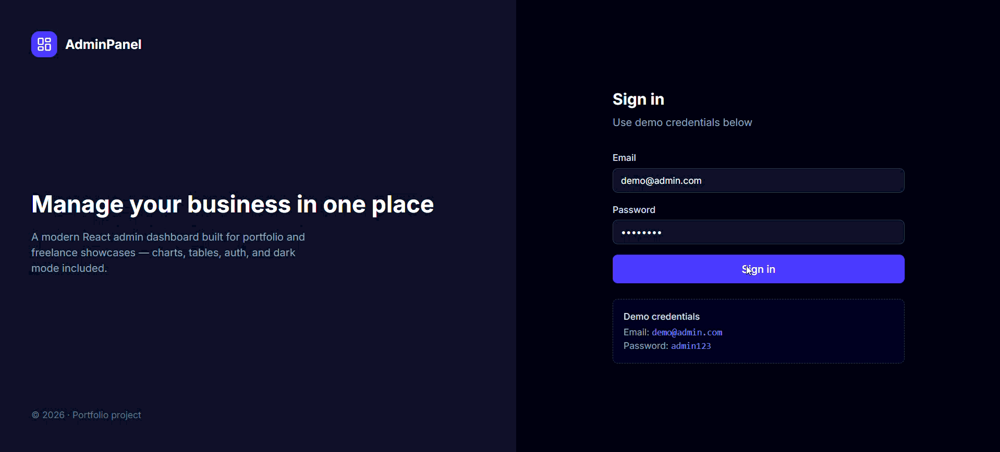
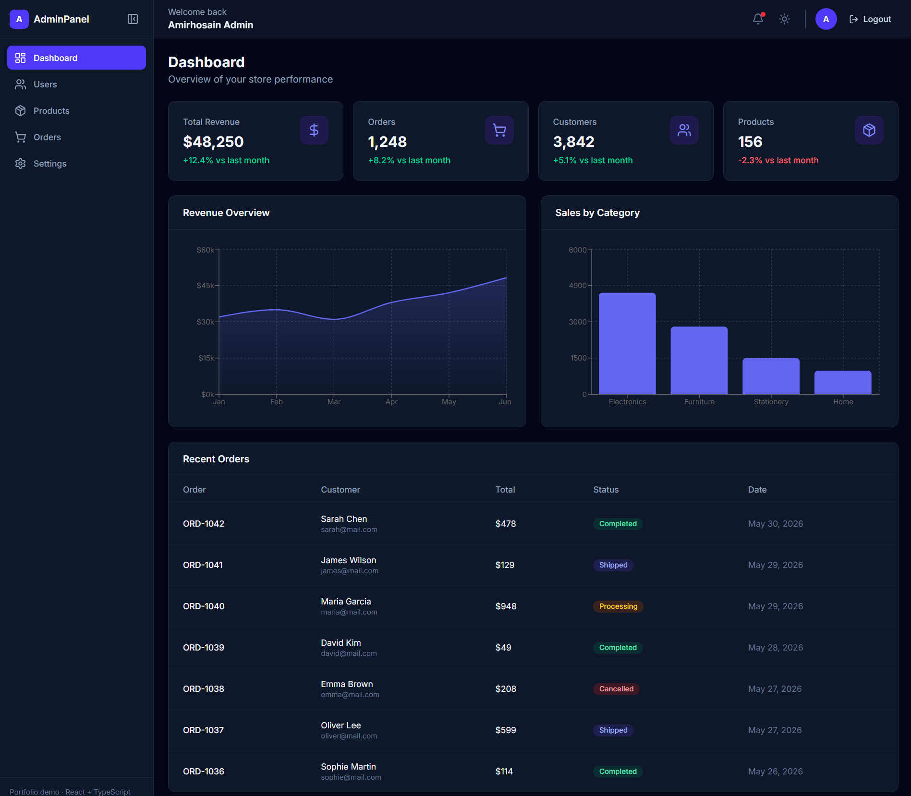
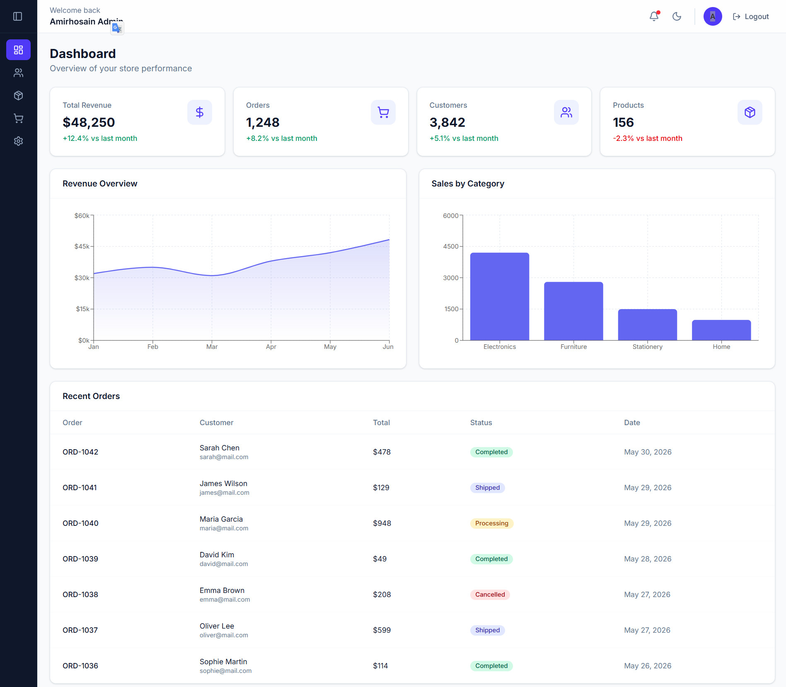
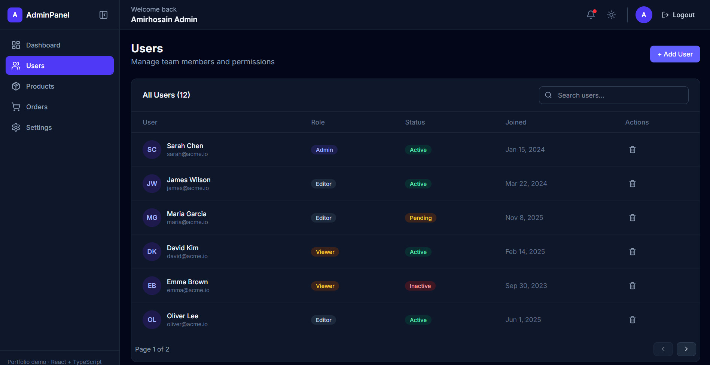
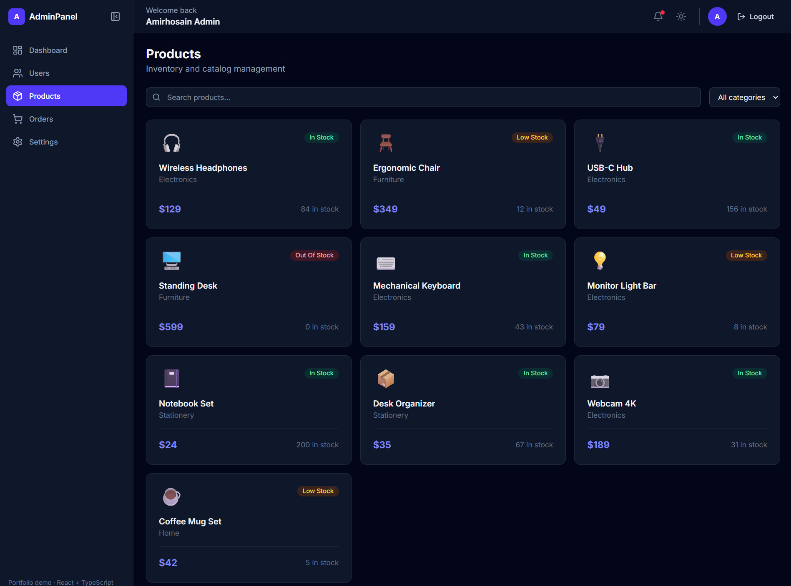
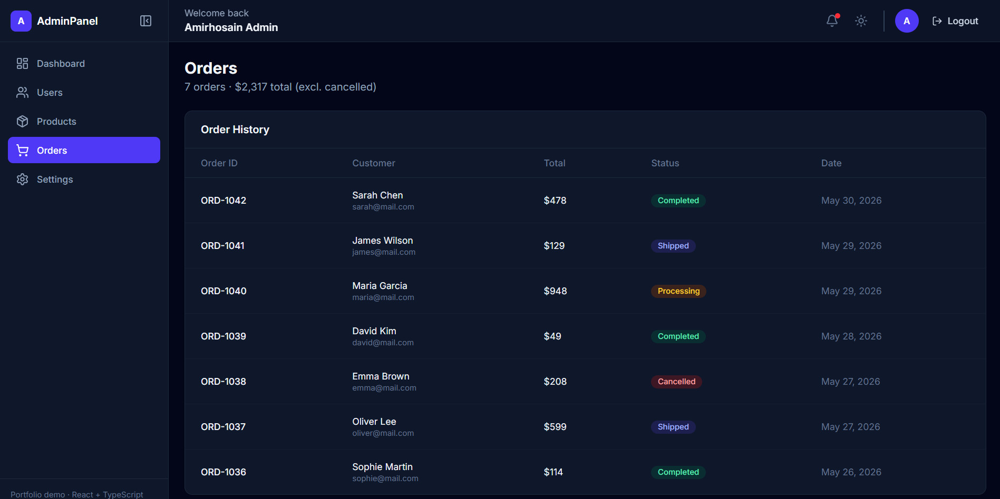
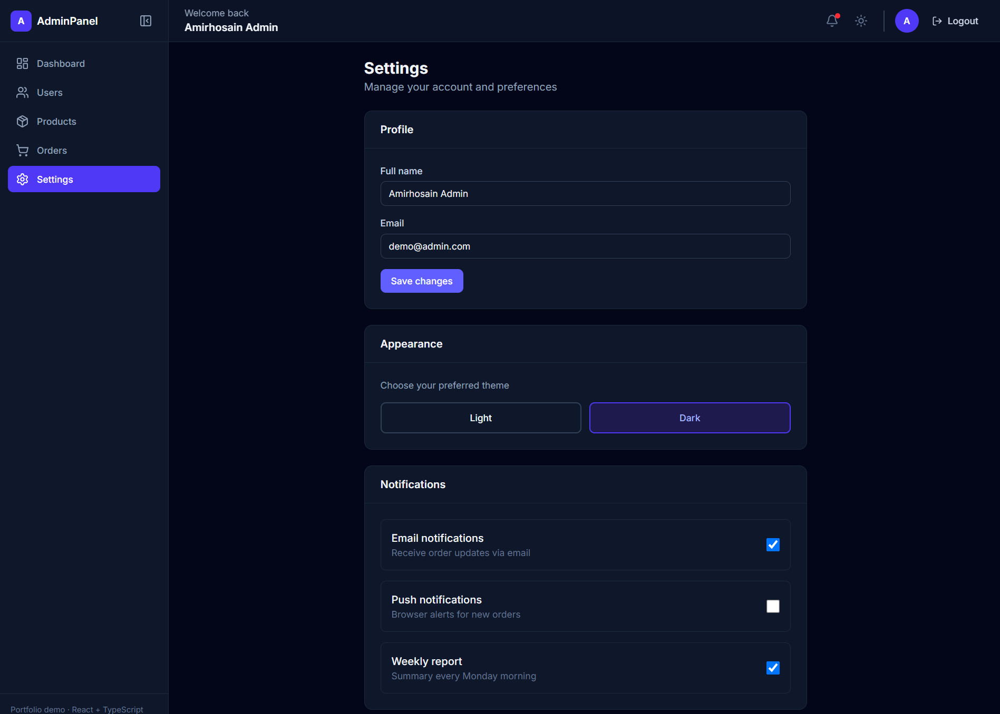
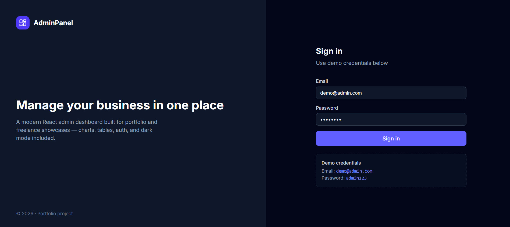

# 📊 AdminPanel — Modern React & TypeScript Admin Dashboard

A clean, responsive, and modular **E-Commerce & Business Admin Dashboard** built with **React**, **TypeScript**, and **Tailwind CSS**[cite: 1, 9]. Designed to demonstrate real-world frontend architecture, interactive data visualization, theme switching, and full CRUD management workflows[cite: 1, 3, 7].

<p align="center">
  
</p>

---

## ✨ Key Features

- **🔐 Authentication Flow:** Dedicated Sign-In view with pre-filled demo credentials (`demo@admin.com` / `admin123`) and protected dashboard routing.
- **🌗 Dark & Light Mode:** Seamless theme toggling across the entire application (persisted via user settings and top-bar switcher)[cite: 1, 2, 6].
- **📈 Interactive Analytics & KPIs:** Real-time overview cards (Revenue, Orders, Customers, Products) with monthly trend indicators, revenue area charts, and category sales bar charts[cite: 1].
- **👥 User & Role Management:** Searchable, paginated user directory with role badges (`Admin`, `Editor`, `Viewer`), account statuses (`Active`, `Pending`, `Inactive`), and user creation/deletion actions[cite: 7].
- **📦 Product & Inventory Catalog:** Card-based product grid featuring instant search, category filtering, pricing, and stock status indicators (`In Stock`, `Low Stock`, `Out Of Stock`)[cite: 5].
- **🛒 Order Tracking:** Detailed order history table displaying order IDs, customer details, totals, dates, and color-coded status badges (`Completed`, `Shipped`, `Processing`, `Cancelled`)[cite: 4].
- **⚙️ Account & System Settings:** Profile management, theme preferences, and granular notification toggles (Email, Push, Weekly Reports)[cite: 6].
- **📱 Collapsible & Responsive Layout:** Adaptive sidebar navigation that collapses cleanly for maximum workspace efficiency[cite: 1, 2].

---

## 🛠️ Tech Stack

- **Frontend:** React, TypeScript[cite: 1, 9]
- **Styling:** Tailwind CSS (Dark/Light theming)[cite: 1, 2]
- **Data Visualization:** Responsive Area & Bar Charts[cite: 1]
- **Icons:** Lucide React

---

## 📸 Screenshots

### Dashboard (Dark & Light Themes)

|                                Dark Mode                                 |                                   Light Mode                                    |
| :----------------------------------------------------------------------: | :-----------------------------------------------------------------------------: |
|  |  |

### Application Views

|                         Users Management                          |                          Products Inventory                          |
| :---------------------------------------------------------------: | :------------------------------------------------------------------: |
|  |  |

|                          Orders History                          |                      Settings & Preferences                      |
| :--------------------------------------------------------------: | :--------------------------------------------------------------: |
|  |  |

### Authentication

<p align="center">
  
</p>

---

## 🚀 Getting Started

### Prerequisites

- Node.js (v18+ recommended)
- npm or yarn

### Installation & Local Development

1. **Clone the repository:**
   ```bash
   git clone [https://github.com/a-pourhasan/react-admin-dashboard.git](https://github.com/a-pourhasan/react-admin-dashboard.git)
   cd react-admin-dashboard
   ```
